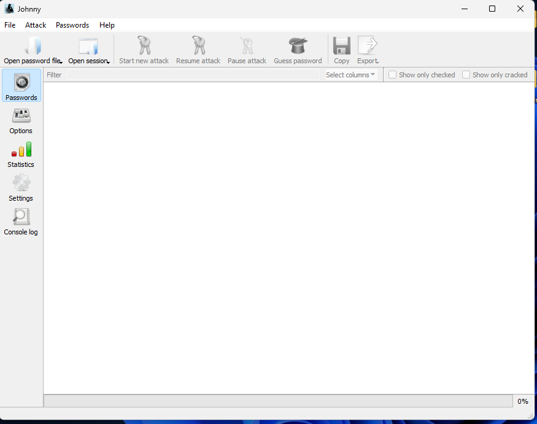
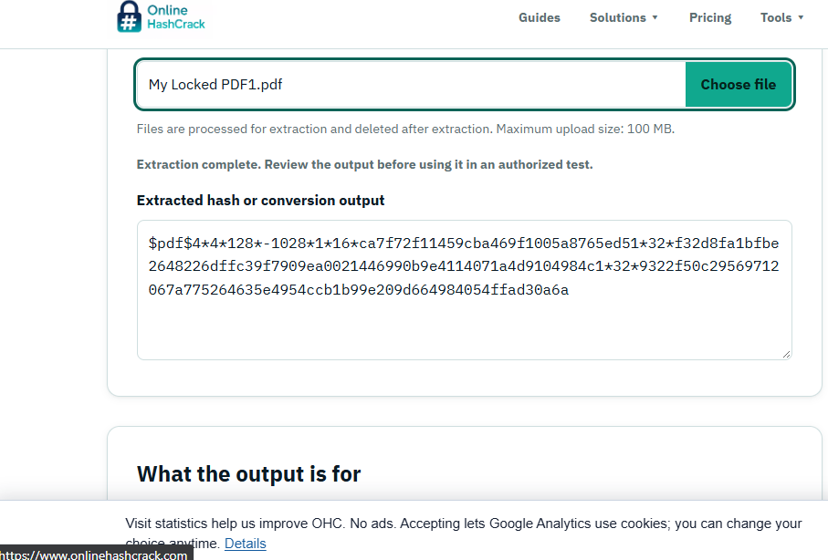
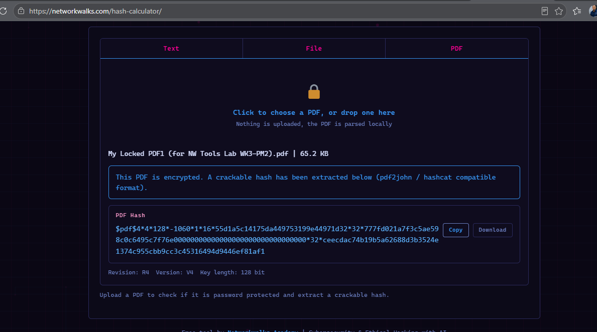
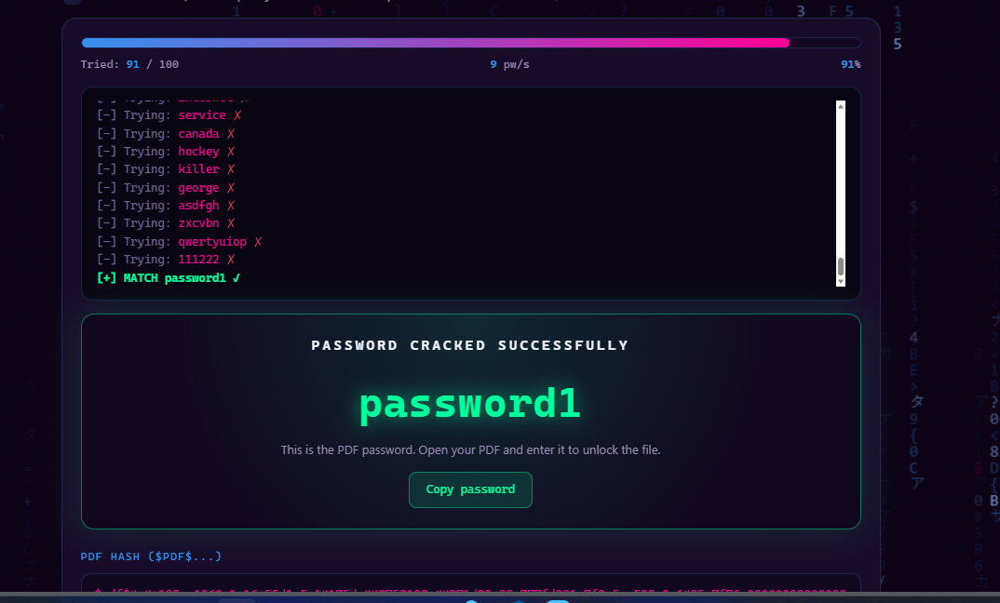
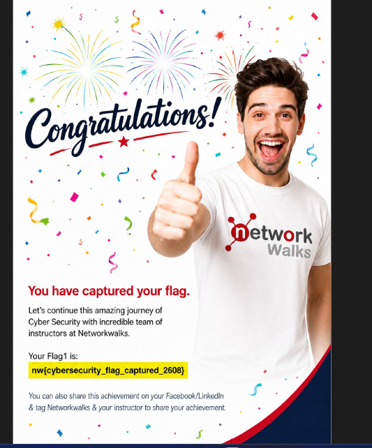
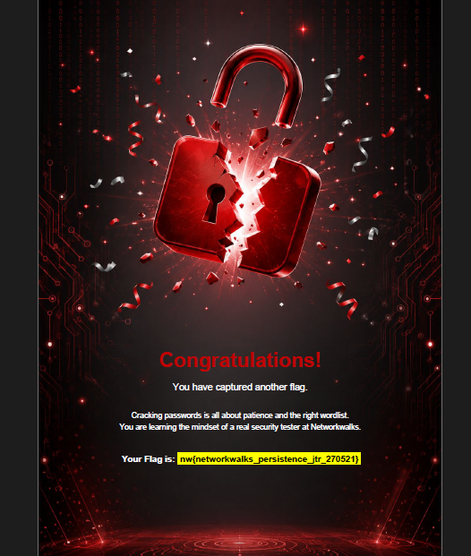
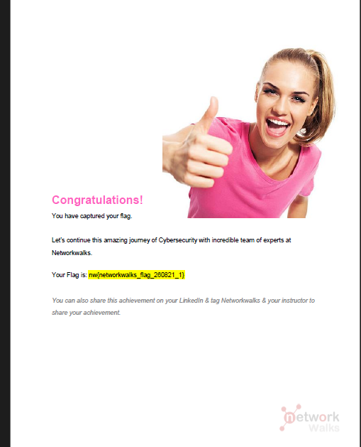

# NETWORKWALKS-Djama-B084-WK3-PM1-PM2-Password-Cracking-JTRV1-NW-Tool-LAB-SETUP
| Field | Detail |
|---|---|
| **Pentester Name (Cybersecurity Professional)** | **Djama Dayib Ahmed** |
| **Program/Batch** | B084-Networkwalks |
| **Date** | 20 November 2026 |
| **Modules completed** | W3-PM1 (Password Cracking(JTRV1)) W3-PM2 Password Cracking (NW Tools) |
| **Target** | 1. Cracking pdf password locked (permission already granted )|
## Project Overview

# 1. PASSWORD CRACKING WITH JTR

John the Ripper (JtR) is a widely used password-auditing tool that helps security professionals assess password strength. Johnny provides a graphical interface for John the Ripper. Both tools are commonly used in authorized security testing and educational labs to study password security.
I have used these tools only on systems and devices that I own or for which I had written authorization. This material is intended for educational and research purposes only.

# 2. Tools Used

The table below lists each tool used in this report and its purpose.

| Tool | Purpose |
|---|---|
| Windows 11           | Operating systems used for installing software for cracking activities  |
| JTR JOHN             | Downloading the software and installing in windows 11                   |
| JTR JOHNNY           | Used for cracking the hash to get the password                          |
| NW Hash Calculator   | Networkwalks tool used for cracking                                     |
| NW Password Cracker  | Password tool used for displaying the password.                         |

# 3. Activities Performed

I used John the Ripper (JtR) and Johnny to audit three password-protected PDF files for which I had authorization. First, I downloaded and extracted John the Ripper and Johnny from the Openwall websites. I then opened Johnny and configured it to use John the Ripper.

Next, I submitted each PDF to the OnlineHashCrack PDF hash extractor and saved the extracted hashes in a text file. I loaded that file into Johnny and ran the password audit. The process successfully recovered the passwords.
I also used Networkwalks Academy’s Hash Calculator and Password Cracker to audit a separate password-protected PDF for which I had authorization. The Hash Calculator extracted the PDF hash locally in my browser, and I used the Password Cracker’s dictionary-attack feature to test a wordlist against that hash. The password was successfully recovered.

# 4. Conclusion & Evidences Collected

During Week 3 of my Cybersecurity & Ethical Hacking training , I completed practical activities covering Password Cracking using JTR JOHNNY , Networkwalks Hash Calculator and NW Password Cracker. 
Here below are the screenshot : 

